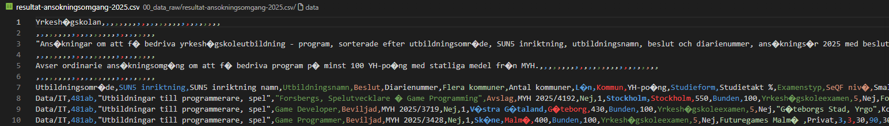
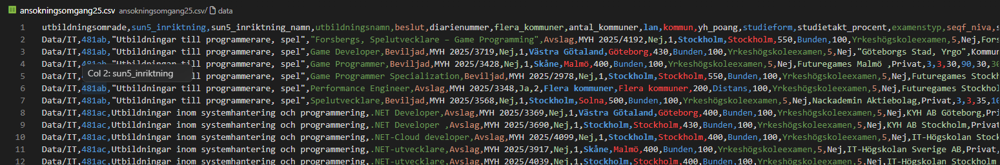
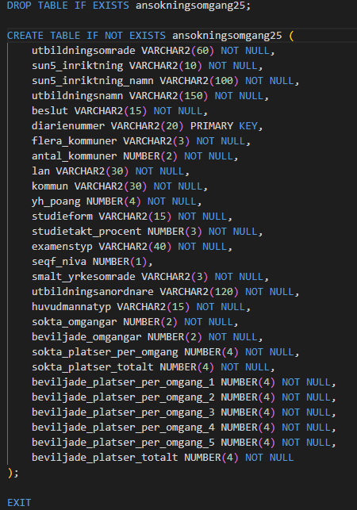
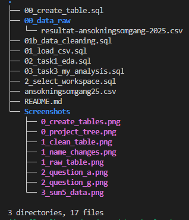
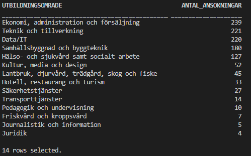
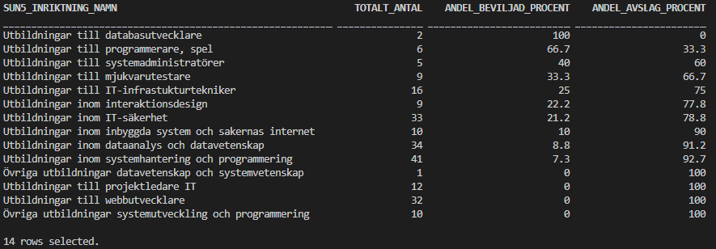
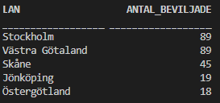

# the_skool_Johan_Jerras
  SQL-analys av Myndigheten för yrkeshögskolans (MYH) beslut i ansökningsomgång 2025,
  framtagen som stöd för utbildningsanordnaren The Skool. Projektet är en labb i SQL (Oracle).

## Innehåll
- [Data](#data)
- [Tabell](#tabell)
- [Teknik](#teknik)
- [Kom igång](#kom-igång)
- [Projektstruktur](#projektstruktur)
- [Intervju med domänexpert](#intervju-med-domänexpert)
- [Uppgift 1 – Grundläggande EDA](#uppgift-1--grundläggande-eda)
- [Uppgift 3 – Egna frågor](#uppgift-3--egna-frågor)
- [Antaganden och begränsningar](#antaganden-och-begränsningar)
- [Presentation och video](#presentation-och-video)
- [Användning av LLM](#användning-av-llm)


## Data
- Datan är hämtad från:
  https://www.myh.se/yrkeshogskolan/resultat-ansokningsomgangar/resultat-for-program
- Datan som bearbetas och analyseras kommer från "tabell 3" ur detta material. 
- Datan i xlsx-filen "resultat-ansokningsomgang-2025" formateras om till en
csv-fil, csv-filen exporteras till Linux genom scp.
- Den råa datafilen är: resultat-ansokningsomgang-2025.csv
- Den bearbetade datafilen är: ansokningsomgang25.csv
- Jag konverterar teckenkodningen (WINDOWS-1252 → UTF-8):
```bash 
  iconv -f WINDOWS-1252 -t UTF-8 resultat-ansokningsomgang-2025.csv 
```
- Jag tar bort de 6 första raderna som innehåller annat än data med:
```bash
  tail -n +7 > ansokningsomgang25.csv 
```
Före: 
Efter: 

- Jag använder filen 1_load_csv.sql för att ladda in min data i Oracle SQL.
- I "1b_data_cleaning.sql" använder jag TRIM, REGEXP_LIKE och INSTR för att ta bort  
extra blanksteg samt eventuella hårda mellanslag.
```sql
utbildningsnamn      = TRIM(REGEXP_REPLACE(utbildningsnamn,      '[[:space:]]+', ' ')),
utbildningsanordnare = TRIM(REGEXP_REPLACE(utbildningsanordnare, '[[:space:]]+', ' ')),
sun5_inriktning_namn = TRIM(REGEXP_REPLACE(sun5_inriktning_namn, '[[:space:]]+', ' '));
```

## Tabell
- Jag väljer att skapa mina egna tabeller i "0_create_tables.sql" för att ha    
bättre kontroll över datan och hur den presenteras.
- Jag väljer att använda det unika "diarienummer" som Primary Key istället för 
att skapa en ny då dessa redan har radspecifika värden.
- Mina tabeller utifrån datan: 
![Bearbetad tabell - 0_create_tables.sql]!

- Jag skapar även en extra "stödtabell" i "1b_data_cleaning.sql" där jag slår  samman vissa namn där stavning och liknande skilljer sig. Jag väljer att vara restriktiv med denna åtgärd för att inte påverka "rådatan" för mycket. Man skulle kunna välja att slå ihop flera liknande namn både under utbildningsnamn och utbildningsanordnare men då riskerar även information och nyanser ur "rådatan" att försvinna.
  
1b_data_cleaning.sql:
```sql
-- Skapar en tabell för att mappa olika varianter av utbildningsnamn till ett kanoniskt namn.
CREATE TABLE namn_mappning (
    variant         VARCHAR2(150) PRIMARY KEY,
    kanoniskt_namn  VARCHAR2(150) NOT NULL
);
```

## Teknik
- Oracle AI Database 26ai Free (Release 23.26.3.0.0), SQLcl
- Linux-VM, Git/GitHub, VS Code, Git bash

## Kom igång
SQL-skripten laddas i följande ordning:
00_create_table.sql -> 01_load_csv.sql -> 01b_data_cleaning.sql
-> 02_task1_eda.sql or 03_task3_my_analysis.sql

## Projektstruktur


## Intervju med domänexpert
En intervju hölls med en represtentant från The Skool tillsammans med andra kollegor
där vi kunde ställa frågor om deras intressen utifrån datan.

Några intressanta observationer från intervjun:
- The Skool uttryckte ett intresse för samtliga utbildningsområden och geografiska platser men då datan är omfattande så valde jag trots detta att främst fokusera på utbildningar inom "Data/IT" men med ett brett geografiskt perspektiv.
- Det uttyrcktes ett intressa att jämföra Beviljandegraden utifrån antal sökta omgångar exempelvis.
- Det uttrycktes även ett intresse för att undersöka eventuella skillnader inom SUN5-inriktning.
- The Skool uppgav att man inte var begränsde av: geografisk plats, utbildningsområde, utbildningsform eller examenstyp.

## Utformning av SQL-queries
Utformningen av de analyser av datan som utförs bygger på skriftliga instruktioner från "The Skool" samt den intervju som skedde med "stakeholder/domänexpert" (2026-10-21).
Jag har valt att fokusera extra på två områden: 
- Fördjupning inom "Data/IT" och relaterade utbildningar.
- Undersökning av beviljandegrad beroende på antal sökta omgångar samt utifrån län.

De skriftliga frågorna (a-i) från The Skool och tillhörande queries finns här:
"02_uppgift1_eda.sql"

Fråga a: Exempeltabell - Ger en överblick över de olika utbildningsområdena.




De frågor jag själv utformat och tillhörande queries finns här:
"03_uppgift3_egna_fragor.sql"
De frågor jag valt att undersöka är:
1. Beviljade respektiva avslagna utbildningar utanför utbildningsområdet 'Data/IT' som innehåller "Data/IT relaterade" ord, listade efter utbildningsområde. (Två olika tabeller).
2. Andel beviljade/avslag utifrån SUN5-område inom Data/IT.
3. Andel beviljade utbildningar i procent utifrån antal sökta omgångar samt  Andel beviljade utbildningar i procent utifrån antal sökta omgångar inom "Data/IT". (Två olika tabeller).
4. Andel beviljade utbildningar i procent utifrån län.

Exempel på svaret på fråga 2 "Andel beviljade/avslag utifrån SUN5-område inom Data/IT".


Jag valde dessa då de enligt mig erbjuder en fördjupning inom "Data/IT" särskillt förhållandet till SUN5-område och andra utbildningsområden. Detta kan vara intressant i utformningen av eventuella utbildningar och deras ansökningar. Detta gäller även datan gällande "beviljade utifrån ansökda omgångar" som kan vara ett underlag för hur ansökan bör utformas samt hur många ansökningsomgångar man bör planera för. Jag tog med frågan om "beviljade utifrån län" då The Skool var tydliga att man inte är geografiskt bundna och detta skulle kunna vara en konkurransfördel vilket är värt att undersöka.

## Antaganden och begränsningar
Under arbetet har jag varit tvungen att göra vissa begränsningar och antaganden utifrån datan, det är bedömningar som man hade kunnat göra annorlunda och jag kommer här motivera några av de val som jag gjorde:
- Under kolumnen "beslut" finns det en ensam rad kallad "återkallad", jag har valt att helt förbise detta då det har väldigt liten påverkan på resultatet men det kan vara värt att nämna.
- På fråga "d-f" hade jag i större utsträckning kunnat ändra snarlika namn på utbildningar, detta hade kanske kunnat ge en tydligare data och kanske fått vissa utbildningar att särskilja sig mer i resultatet av mina sökningar. Jag valde att exempelvis inte översätta utbildningar mellan engelska och svenska då jag anser att information om den specifika utbildningen och eventuella skillnader riskeras att gå miste om. Samma gäller utbildnigar med ett "tilläggs ord" eller prefix/sufix.

Screenshots/1_name_changes.png

- På fråga "f" hade jag lite svårt att veta vad som efterfrågades; Utbildningsanordnare OCH Utbildningsnamn i en tabell eller i två separata tabeller. Det slutade med att jag gjorde alla tre alternativen.
- Under fråga "f" hade jag också i större utsträckning kunnat valt att slå ihop utbildningsanordnare med liknande namn och provade även den lösnigen men valde att inte göra det då frågan uttryckligen nämner "Administrativ enhet" och jag ville då inte att denna information skulle försvinna ur datan.
- På fråga "g" fick jag först fram alternativet "Flera kommuner" som mest vanligt förekommande län, då jag inte visst säkert hur jag skulle hantera detta svaret valde jag att filtrera bort det i mitt querie. Jag la även till en "WITH TIES" för att försäkra mig om att det inte var fler län på samma antal som riskerade att falla bort i min tabell då jag valde de 5 första raderna.
```
Alla ansökningar: Beviljade: 462	Avslag: 721	Totalt: 1184 (inkl. 1 återkallad)
“Flera kommuner”: Beviljade: 103	Avslag: 192	Totalt: 295
Ett enskilt län: Beviljade: 359	Avslag: 529	Totalt: 889 (inkl. 1 återkallad)
```
Fråga g: Exempeltabell - Antal beviljade utifrån län då jag rensat bort svaret "Flera län":


## Användning av LLM
LLM har använts som bollplank, för att förklara vissa specifika moment och för att granska SQL-frågor samt som inspiration gällande innehåll i README och videopresentation.
Jag har gått igenom och förstår all kod, jag har skrivit den absoluta majoriteten av koden själv men vissa delar kan vara tagna från andra omarbetade exempel och i vissa undantagsfall har jag använt VS Code's IntelliSense funktion för att slutföra de delar av koden som varit mer repetitiv.


## Ignorerade filer/filtyper
  Se .gitignore
