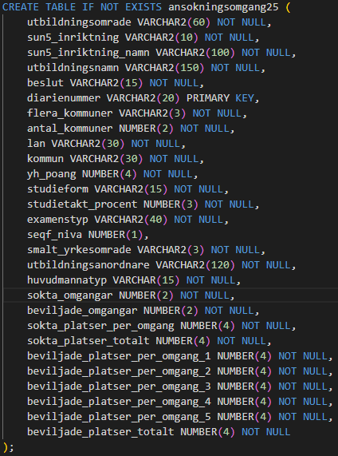

# the_skool_Johan_Jerras

## Förberedelse av data
    - Datan är hämtad från: https://www.myh.se/yrkeshogskolan/resultat-ansokningsomgangar/resultat-for-program
    - Datan som bearbetas och analyseras kommer från "tabell 3" ur detta material. 
    - Datan i xlsx-filen "resultat-ansokningsomgang-2025" formateras om till en csv-fil, csv-filen exporteras till Linux genom scp.

## Behandling av data
    - Den råa datafilen är: resultat-ansokningsomgang-2025.csv
    - Den bearbetade datafilen är: ansokningsomgang25.csv
    - Jag behandlar datan bland annat genom TRIM(utbildningsnamn).
    - Jag tar bort "åäö" ur de kolumner som innehåller dessa.
        iconv -f WINDOWS-1252 -t UTF-8 resultat-ansokningsomgang-2025.csv \  <- konverterar teckenkodningen
    - Jag tar bort de 6 första raderna som innehåller annat än data.
        tail -n +7 > ansokningsomgang25.csv  <- Tar bort de första raderna

## Förberedelse av tabeller
    - Jag väljer att skapa mina egna tabeller i "0_create_tables.sql" för att ha bättre kontroll över datan och hur den presenteras.
    - Jag väljer att använda det unika "diarienummer" som Primary Key istället för att skapa en ny då dessa redan har radspecifika värden.
    - Mina tabeller utifrån datan: 
    
    - Jag använder filen 1_load_csv.sql för att ladda in min data i Oracle SQL.

## Utformning av SQL-queries
    - Utformningen av de analyser av datan som utförs bygger på skriftliga instruktioner från "The Skool" 
    samt den intervju som skedde med stakeholder och domänexpert (2026-10-21).
    - Jag har valt att fokusera extra på två områden: 
        - Fördjupning inom "Data/IT" och relaterade utbildningar.
        - Undersökning av beviljandegrad beroende på antal sökta omgångar 
        samt utifrån län.
    - De frågor som The Skool velat ha svar på:
    a) Antal ansökningar per utbildningsområde, sorterat på flest
    ansökningar
    b) Antal BEVILJADE ansökningar per utbildningsområde
    c) Antal AVSLAGNA ansökningar per utbildningsområde
    d) Antal BEVILJADE ansökningar per utbildningsnamn inom Data/IT
    e) Antal AVSLAGNA ansökningar per utbildningsnamn inom Data/IT
    f) Antal BEVILJADE ansökningar per utbildningsanordnare
    administrativ enhet & utbildningsnamn, inom Data/IT
    g) Topp 5 län efter antal beviljade ansökningar
    h) Andel distans och andel bundna utbildningar inom respektive
    utbildingsområde
    i) Antal utbildningar som innehåller ordet AI
    - Ytterliggare frågor som formulerats utifrån intervjun:
    j) Beviljade utbildningar utanför utbildningsområdet 'Data/IT' som innehåller "Data/IT relaterade" ord, listade efter utbildningsområde.
    (valda ord: ai, it, digital, digitalt, data, nätverk, programmering, databas)
    k) Avslagna utbildningar utanför utbildningsområdet 'Data/IT' som innehåller "Data/IT relaterade" ord listade efter utbildningsområde.
    l) Andel beviljade/avslag utifrån SUN5-område inom Data/IT, i procent.
    m) Andel beviljade utbildningar utifrån antal sökta omgångar i procent.
    n) Andel beviljade utbildningar utifrån antal sökta omgångar i procent,
    inom utbildningsområdet "Data/IT".
    o) Andel beviljade utbildningar i procent utifrån län.

    - Samtliga SQL-queries finns i filen: 2_select_full.sql